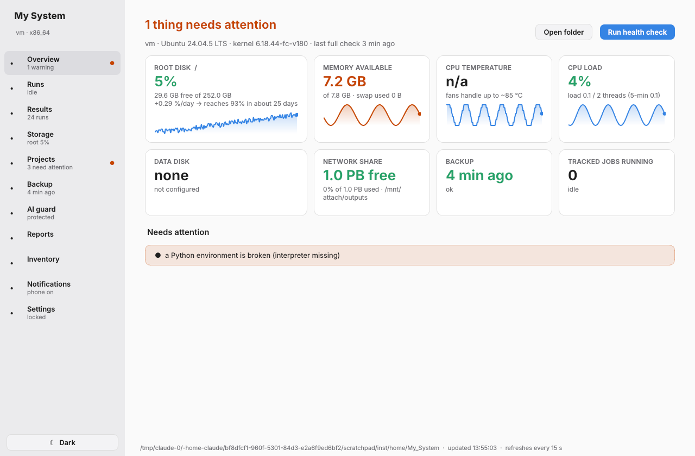
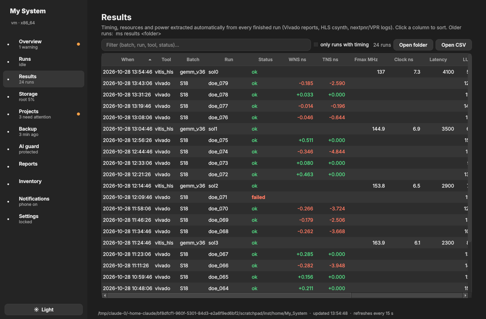

# my-system

A self-hosted **health, run-tracking, backup and AI-guard toolkit for Linux workstations** —
built for research machines that run long EDA/simulation jobs (Vivado, Vitis HLS, yosys/nextpnr,
gem5, Sniper, Verilator, …) and are increasingly driven by AI coding assistants.

One installer, auto-detection of the machine, a desktop app, phone notifications, and no
machine-specific code: everything specific lives in a few config files.

| Overview | Results (dark) |
|---|---|
|  |  |

## What it does

| Area | What you get |
|---|---|
| **Health** | Daily check (disks, mounts, memory, CPU heat, failed services, toolchains, Python environments, watched config files, backups, updates) with a dated report and a short summary. |
| **Long runs** | A one-minute watcher recognises jobs through plugins, reports **failures at once** (with the first `ERROR:` line) and sends **one summary per finished batch** (e.g. a whole DOE sweep). `vrun <cmd>` wraps any command; `tsp vrun <cmd>` queues them. |
| **Queue & flows** | `ms q add -- CMD` queues a job; the scheduler starts it only when the CPU threads and RAM it needs are free (measured per tool), pauses the newest low-priority job when RAM runs low, retries out-of-memory runs with more memory, enforces timeouts and hard memory limits (cgroups), honours dependencies, priorities and preemption. **Flow files** (YAML) describe steps, parameter sweeps (matrix), per-item dependencies, preconditions, hooks, temporary files and incremental re-runs (skip when inputs are unchanged); `ms flow check` validates and estimates the run time; flows can run on a cron schedule, when the machine is idle, or on every new commit. Efficiency report (`ms q report`), timeline (`ms q timeline`), Prometheus metrics, and a **Queue** page with a Gantt chart. |
| **Software** | `ms software`: every apt/snap/flatpak/pip update with **who uses it** (projects, Python environments, packages that link the library, programs running now) and what to do — safe now, test after, after the runs, needs reboot. `ms software uses NAME` answers "who uses numpy / libboost / vivado 2023.2 / this venv?". |
| **Self-test** | `ms selftest` checks the installation and runs end-to-end jobs in a separate temporary queue — your real jobs and simulations are never touched. |
| **MCP server** | `ms mcp` (registered for Claude Code by the installer): assistants ask for capacity, queue jobs, run flows and read run logs directly. |
| **Run logs** | One standard log format for every project (`msrun.jsonl`, [spec](src/runlog/RUNLOG_SPEC.md)): start, stages, errors, metrics, files, end. Helpers for Python, Tcl/Vivado and any command (`ms log run -- CMD`), a validator (`ms log check`), and a *Run logs* page that lists every run found in your project folders. AI assistants must use it. |
| **Results** | Timing, resources and power are extracted from every finished run into `reports/results.csv` (Vivado timing/utilization/power reports, Vitis HLS `csynth.xml`, nextpnr/VPR logs). Older runs: `ms results <folder>`. |
| **Capacity advice** | Warns when the CPU is oversubscribed and suggests how many jobs to run in parallel, from measured per-job CPU and RAM. Tells you when a pending reboot can be done because nothing is running. |
| **Storage** | Hourly samples, a 30-day chart, a root-disk **forecast** ("reaches 93% in 12 days"), fast-fill alerts, daily folder sizes, and *Move to data disk* (copy → verify → symlink, refused while in use). |
| **Projects** | Git status of every repository found: uncommitted work, unpushed commits, no remote, not covered by the backup. |
| **Backup** | Encrypted, deduplicated [borg](https://www.borgbackup.org/) backup every night, passphrase in the desktop keyring, retention 7/4/6, and a **monthly restore test** that really restores files and compares them. |
| **AI guard** | For Claude Code: a root-owned managed policy plus a `PreToolUse` hook that blocks writes to protected paths (system, toolchains, environments, shell start-up files, my-system itself) — including shell redirections that permission rules miss — and logs every tool call. AI instructions are split into fixed rules + a **system map regenerated daily**, so assistants know where everything is without searching the disk. |
| **Capacity** | Every finished job is measured (peak RAM, CPU cores, time) per tool. `ms capacity` says how many more jobs fit right now; AI assistants get the machine's spec plus concrete rules (queue with `tsp`, cap threads, Vivado `maxThreads`, outputs on the data disk) so they use the whole machine without overloading it. |
| **Notifications** | Desktop + phone via [ntfy](https://ntfy.sh) (private random topic). Weekly digest every Friday. |
| **Hardware** | A small root-owned collector reads disk health (SMART: wear, bad sectors, errors, unsafe shutdowns), memory modules and available firmware updates once a day — read-only, installed outside your home. Fans, sensors, zram and Secure Boot are read without root. |
| **Full report** | `ms report` (and automatically on the 1st of each month) writes one complete report — summary, hardware, memory, storage and disk health, cooling, OS and security, software, Python environments, projects, backup, **what changed since last time** and prioritised recommendations — shown on the app's **System report** page (also saved as HTML and as Markdown for AI assistants). |
| **Tamper evidence** | Code, rules and config are root-owned; watched files are fingerprinted daily and changes are reported. |

## Install

```bash
git clone https://github.com/<you>/my-system.git
cd my-system
./install.sh          # asks before installing packages; --yes for defaults
```

Requirements: Linux with systemd user services, Python 3.10+, PyQt6 (`python3-pyqt6`).
Optional: `borgbackup` + `libsecret-tools` (backup), `task-spooler` (queue), `curl` (phone alerts).
Tested on Ubuntu 26.04; Debian/Fedora/Arch should work (install the packages yourself).

The installer detects data disks, network shares, toolchains (Vivado/Vitis, ISE, Quartus,
MATLAB, oss-cad-suite, conda, CUDA, Docker data root), Python environments and git projects,
writes starting config files, installs user timers, the app launcher, the `ms` and `vrun`
commands, the Claude Code policy, and locks everything. Re-run it to update; your config,
reports and state are kept.

## Daily use

```text
ms                 status at a glance
ms gui             the desktop app (also in the app menu as "My System")
ms check           full health check now
ms report --open   full system report (HTML + Markdown)
ms capacity        how many more jobs fit right now
ms q add -- CMD    queue a job (starts when CPU and RAM are free)
ms q / ms q report jobs / efficiency (memory and CPU reserved vs used)
ms flow example    example flow file (steps, sweeps, dependencies)
ms flow check F    validate a flow and estimate its run time
ms flow run F      queue every job of a flow (--resume skips finished ones)
ms software        updates and who uses what; ms software uses NAME
ms selftest        safe end-to-end test of this installation
ms lineage FILE    which run produced this file, which runs used it
ms log run -- CMD  run anything and record it in the standard run log
ms log check DIR   validate run logs against the format
ms log list        all runs, newest first
ms hw              disk health, memory modules, fans, firmware
ms results DIR     extract results from existing run folders
ms git             project status
ms move FOLDER     move a folder to the data disk, leave a link
ms backup-setup    one-time backup setup
ms unlock / lock   edit config (needs sudo)
ms doctor          self-check
vrun <cmd>         run anything long and get notified
```

## Layout

```
~/My_System/
  bin/ lib/ plugins/ gui/ ai/ systemd/   code (root-owned, read-only)
  config/                                your settings (root-owned; ms unlock to edit)
    my_system.conf        disks, shares, alert levels, run-tracking tuning
    protected_paths.txt   paths AI assistants may not write to
    watched_files.conf    files fingerprinted daily
    size_folders.txt      AUTO or an explicit list
    backup_sources.txt / backup_excludes.txt / backup.conf
    plugins.conf          enabled run-tracking plugins
    paths.conf            extra label|path entries for the AI system map
  state/                  detected.json, SYSTEM_MAP.md, AGENTS.md, watcher state, keys
  reports/                daily reports, metrics.csv, results.csv, runs.jsonl, ai_audit/, weekly/
```

## Flow files

```yaml
name: s18_doe
cwd: /mnt/data/me/S18
defaults: {tool: vivado, retries: 1, retry_on: [oom], timeout: auto}
require: ["mounted /mnt/data", "free_gb /mnt/data 50"]
steps:
  - name: synth
    matrix: {seed: [1, 2, 3], strategy: [Explore, Default]}
    folder: "doe_{{seed}}_{{strategy}}"
    cmd: "vivado -mode batch -source ../synth.tcl -tclargs {{seed}} {{strategy}}"
    inputs: ["../rtl/*.v", "../synth.tcl"]      # unchanged inputs + existing outputs -> skipped
    outputs: ["post_synth.dcp"]
  - name: impl
    matrix: synth                              # each impl waits only for its own synth
    depends: [synth]
    folder: "doe_{{seed}}_{{strategy}}"
    cmd: "vivado -mode batch -source ../impl.tcl"
    temp: [".Xil", "*.jou"]
on_success: "python3 collect.py"
```

Step keys: `cmd matrix folder depends dep_mode inputs outputs temp require mem_gb cores gpus priority
retries retry_on timeout nice limit_memory container host when_idle preempt env tool incremental params`.
Schedules: `ms flow schedule FILE --cron "17 2 * * *" | --idle | --on-commit ~/repo[:branch]`.

Not included on purpose: user accounts and roles (single-user workstation; the AI guard is the access
control), a graphical flow editor (flow files are short text; `ms flow check` shows the plan).

## Writing a plugin

A plugin is one Python file in `plugins/`, enabled in `config/plugins.conf`:

```python
import re
from mysys.plugins import count_log, find_log, newest

MATCH = re.compile(r"(?:^|/)(mytool)$")          # program name; group 1 = tool name
LOGS = {"mytool": ["mytool.log"]}

def log_summary(cwd, tool):                       # errors / critical warnings
    f = find_log(cwd, LOGS[tool]); return count_log(f) if f else None

def results(cwd, tool):                           # any columns of results.csv
    return {"fmax_mhz": 412.0}
```

## Security notes

- The hardware collector (`/usr/local/lib/my-system/ms-hwinfo`, `my-system-hwinfo.timer`) is the only
  part that runs as root. It only reads (smartctl, dmidecode, fwupdmgr), lives in a root-owned
  location, never imports code from your home, and stores no serial numbers.
- The guard is a strong safety net, not a sandbox: an assistant with arbitrary code execution
  can still find creative ways around pattern checks. Keep reviewing permission prompts.
- The ntfy topic works like a password; messages contain status text only, never file contents.
  Use `NTFY_SERVER` to point at a self-hosted ntfy server.
- The borg passphrase lives in your desktop keyring; keep a copy (and `state/borg-key-backup.txt`)
  off the machine.

## Uninstall

`./uninstall.sh` removes timers, launcher, commands and the policy; your data folder is kept.

## License

MIT
